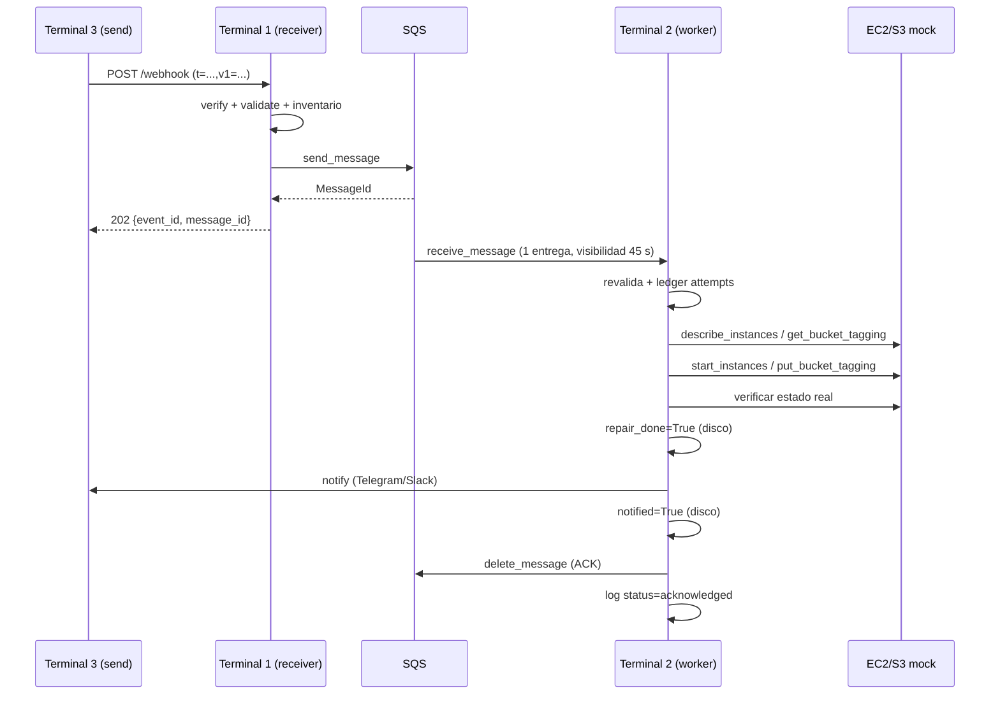

# Proyecto Fénix — Sistema de Autorreparación de Infraestructura

TP Final 1 · Programación para Automatización II · Opción 4.3.1 · UPATECO 2026

---

## 1. Objetivo del sistema

Recibir una alerta de laboratorio mediante un **webhook autenticado con HMAC-SHA256**,
guardarla en **SQS estándar con DLQ**, **reparar un recurso emulado por Boto3**
(instancia EC2 detenida → `running`, bucket S3 → etiquetas obligatorias restauradas) y
**comunicar el resultado a Telegram o Slack**, dejando el resultado en un ledger durable.

El circuito completo se ejecuta por API contra LocalStack (nunca AWS real):

```
alerta firmada → receptor FastAPI → SQS (+DLQ) → worker → repair convergente
              → aviso → ledger data/events.json → ACK (delete_message)
```

Invariantes que sostienen el diseño:

- El receptor **no repara**: autentica, valida y encola; responde `202` sólo después de
  que SQS confirma `send_message`.
- El worker **consulta el estado real antes y después** de cada cambio.
- Repetir un evento o reiniciar el worker **no repite** acciones ya verificadas.
- Los mensajes fallidos **se conservan** (backoff + `RedrivePolicy`) y llegan a la DLQ.

---

## Video de Defensa
* **Link al Video**: https://youtu.be/tQpktDeq1RY 

---

## 2. Integrantes y roles


| Rol técnico | Apellido y nombre | Correo | Módulos principales | Pruebas defendidas |
|---|---|---|---|---|
| Integrante 1 — Entradas y Excepciones | Melani Del Rosario Tolaba | melani.tolaba.prof@gmail.com | `utils/validation.py`, `services/events.py`, `utils/errors.py` | F04 (entradas), F07 (contrato) |
| Integrante 2 — Mensajería e Inventario Cloud | Melani Del Rosario Tolaba | melani.tolaba.prof@gmail.com | `services/sqs.py`, `services/demo.py` | F01 (colas), F10 (DLQ) |
| Integrante 3 — Webhooks y Reparación | Melani Del Rosario Tolaba | melani.tolaba.prof@gmail.com | `utils/crypto.py`, `services/receiver.py`, `services/remediation.repair` | F04/F05/F06 (firma), F02/F03 (reparación) |
| Integrante 4 — Observabilidad y Comunicación | Melani Del Rosario Tolaba | melani.tolaba.prof@gmail.com | `utils/logging_json.py`, `services/notifications.py` | F14 (aviso), F16 (logs) |
| Integrante 5 — Integración y Worker | Melani Del Rosario Tolaba | melani.tolaba.prof@gmail.com | `services/worker.py`, `services/remediation.handle`, `cli.py` | F09 (backoff), F11/F12 (idempotencia) |
| Integrante 6 — Pruebas y Diagnóstico | Melani Del Rosario Tolaba | melani.tolaba.prof@gmail.com | `tests/` (todo el módulo), `demo.inject_fault` | F08/F13 (DLQ y 503) |

Debido a la falta de compañeros, asumí la totalidad de los roles, realizando la implementación, las pruebas y la defensa de cada módulo.

---

## 3. Prerrequisitos y versiones

| Componente | Versión usada | Observación |
|---|---|---|
| Python | 3.13 (>= 3.11 obligatorio) | Misma versión para todo el grupo |
| Docker Desktop | 29.9.3 | Debe estar iniciado |
| LocalStack | `localstack/localstack:4.14.0` (community) | Alternativa sin token; ver §5 |
| boto3 / botocore | 1.44.7 | SDK oficial apuntado a loopback |
| FastAPI / uvicorn | 0.165.0 | Receptor HTTP |
| pytest | 9.x | Marcas `base`, `pendiente`, `integracion` |
| Versiones exactas | `requirements-lock.txt` | Generado con `pip freeze` |

---

## 4. Instalación desde cero

### 4.1 Opción rápida (recomendada): script de instalación

```powershell
# Detecta/instala Python y Docker Desktop (winget), crea .env y .venv,
# levanta LocalStack, crea colas y laboratorio y corre las 50 pruebas.
powershell -ExecutionPolicy Bypass -File scripts\instalar.ps1

# Variante al llegar de otro equipo (borra data/ y logs/ y arranca laboratorio nuevo):
powershell -ExecutionPolicy Bypass -File scripts\instalar.ps1 -LimpiaEstado

# Luego, abre las 3 terminales con el menú de pruebas:
powershell -ExecutionPolicy Bypass -File scripts\abrir_terminales.ps1
```

| Script | Qué hace |
|---|---|
| `scripts/instalar.ps1` | Instalación completa y verificada (Python, Docker, `.env`, venv, LocalStack, colas, laboratorio, pytest). Idempotente: se puede reejecutar. `-Reinstalar`, `-LimpiaEstado`, `-SinPruebas` |
| `scripts/abrir_terminales.ps1` | Chequea `.venv`/`.env`/LocalStack/inventario y abre T1 receptor, T2 worker y T3 menú de pruebas. `-DryRun` para ver los comandos sin abrir nada |
| `scripts/menu_pruebas.ps1` | Menú T3 con los casos F01–F16: fallas, duplicados, DLQ, rechazos 401/400/413/422, ledger, cola, estado real y logs |
| `scripts/enviar_pruebas.py` | Cliente de rechazos del webhook (`ok`, `sin-firma`, `firma-vieja`, `json-roto`, `lista`, `alias-ajeno`, `claves-extra`, `grande`) |

### 4.2 Opción manual paso a paso

```powershell
# 1. Clonar el repositorio en una carpeta nueva
git clone <url-del-repositorio>.git
cd <carpeta-del-proyecto>

# 2. Entorno virtual (Python 3.11 o superior)
python -m venv .venv
.\.venv\Scripts\Activate.ps1            # Linux/macOS/WSL: source .venv/bin/activate

# 3. Dependencias del proyecto (o requirements-lock.txt para las versiones exactas)
python -m pip install -r requirements.txt
python -m pip install -e .

# 4. Variables de entorno
Copy-Item .env.example .env             # Linux/macOS: cp .env.example .env
python -c "import secrets; print(secrets.token_urlsafe(32))"
#   -> pegar el resultado en WEBHOOK_SECRET dentro de .env

# 5. LocalStack (Docker)
docker compose up -d
Invoke-RestMethod http://localhost:4566/_localstack/health   # debe responder

# 6. Verificar el apoyo entregado
python -m pytest -m base -q             # debe pasar siempre
python -m pytest -m pendiente -q        # pasa una vez resueltos los TODO
python -m pytest -m integracion -q      # requiere LocalStack corriendo
```

> **Nota sobre la imagen de LocalStack:** la imagen `2026.10.0` indicada en
> `.env.example` exige `LOCALSTACK_AUTH_TOKEN` (plan de la cátedra). Si no se cuenta
> con token, usar `LOCALSTACK_IMAGE=localstack/localstack:4.14.0` en `.env`, que
> incluye `ec2`, `s3` y `sqs` en modo community. No usar `latest`.

---

## 5. Variables de entorno (sin valores privados)

` .env.example ` — los valores reales viven en `.env`, que **nunca** se sube a Git.

| Variable | Propósito | Ejemplo |
|---|---|---|
| `AWS_ENDPOINT_URL` | Endpoint único permitido (loopback:4566) | `http://localhost:4566` |
| `AWS_ACCESS_KEY_ID` / `AWS_SECRET_ACCESS_KEY` | Credenciales ficticias del emulador | `test` / `test` |
| `AWS_DEFAULT_REGION` | Región del laboratorio | `us-east-1` |
| `GROUP_ID` | Identificador del grupo (dueño de los recursos) | `grupo01` |
| `QUEUE_PREFIX` | Prefijo de colas `{prefix}-events` / `{prefix}-dlq` | `fenix-grupo01` |
| `WEBHOOK_SECRET` | Secreto HMAC del webhook (≥ 16 caracteres) | *secreto* |
| `NOTIFY_PROVIDER` | `console`, `telegram` o `slack` | `console` |
| `TELEGRAM_BOT_TOKEN` / `TELEGRAM_CHAT_ID` | Credenciales de Telegram | *secreto* |
| `SLACK_WEBHOOK_URL` | Webhook de Slack | *secreto* |
| `LOCALSTACK_AUTH_TOKEN` | Token de LocalStack sólo si la imagen lo exige | *opcional* |
| `LOCALSTACK_IMAGE` | Imagen fijada por versión | `localstack/localstack:4.14.0` |

El helper `config/settings.client()` rechaza cualquier destino que no sea
`http://localhost:4566` sin usuario ni contraseña, y exige las tres variables AWS:
no existe ningún camino hacia AWS real.

---

## 6. Arquitectura (diagrama Mermaid)

```mermaid
flowchart TD
    CLI[cli send] -->|POST bytes firmados| R[receptor FastAPI :8000]
    R -->|1. verify HMAC ±300 s| V{¿firma válida?}
    V -->|no| E401[401 no publica]
    V -->|sí| J{¿JSON?}
    J -->|no| E400[400 no publica]
    J -->|sí| C{¿contrato + inventario?}
    C -->|no| E422[422 no publica]
    C -->|sí| S[send_message]
    S -->|fallo| E503[503 sin aceptar]
    S -->|ok| A202[202 con message_id]

    S --> Q[(SQS {prefix}-events<br/>VisibilityTimeout 45)]
    Q -->|long polling 10 s| W[worker]
    W -->|revalida contrato| H[remediation.handle]
    H --> L[(ledger data/events.json)]
    H --> REP[repair convergente EC2/S3]
    H --> NOT[notify Telegram/Slack]
    W -->|ACK tras éxito| Q
    W -->|fallo: backoff 2-4-8 s| Q
    Q -->|maxReceiveCount=3| DLQ[({DLQ})]
    DLQ --> EV[evidencias/dlq-*.json]

    REP --> EC2[(EC2 mock)]
    REP --> S3[(S3)]
    L -.-> LOG[logs JSON rotados .gz]
    W -.-> LOG
```

Secuencia nominal completa (§5.6 del enunciado):



---

## 7. Contratos de entrada y salida

### 7.1 Entrada — JSON cerrado, todos los campos obligatorios

```json
{
  "schema_version": 1,
  "event_id": "evt-node-001",
  "event_type": "instance.stopped",
  "resource_id": "node-01",
  "occurred_at": "2026-10-22T18:00:00Z",
  "simulate_failures": 0
}
```

| Regla | Detalle |
|---|---|
| `schema_version` | entero `1` (`True` no vale: `type(...) is int`) |
| `event_id`, `resource_id` | `[a-z0-9-]{3,32}` |
| `event_type` | sólo `instance.stopped` (ec2) o `bucket.tags_missing` (s3) |
| `resource_id` | debe existir en `data/inventory.json` y su tipo debe coincidir con `event_type` |
| `occurred_at` | ISO 8601 con UTC explícito (`Z` o `+00:00`); `-03:00` se rechaza |
| `simulate_failures` | entero 0..5, nunca `bool` |
| Claves | ni sobrantes ni faltantes |

### 7.2 Firma

- `HMAC-SHA256(secret, str(t).encode() + b"." + raw_body)` en hexadecimal de 64 caracteres.
- Cabecera: `X-Webhook-Signature: t=<epoch>,v1=<64 hex>`; exactamente dos claves, sin duplicadas.
- Ventana: `|ahora - t| <= 300` s. Comparación siempre con `hmac.compare_digest`.

### 7.3 Respuestas del receptor

| Situación HTTP | Código | Efecto |
|---|---|---|
| Firma ausente/malformada/incorrecta/fuera de ventana | 401 | no publica |
| Cuerpo > 16 KiB | 413 | no publica |
| JSON roto o UTF-8 inválido con firma válida | 400 | no publica |
| JSON válido pero fuera del contrato o alias ajeno | 422 | no publica |
| Secretos del servidor sin configurar | 500 | no publica |
| SQS no disponible después de validar | 503 | no promete aceptación |
| `send_message` confirmado | 202 | `{status, event_id, message_id}` |

### 7.4 Salidas

- **Ledger** `data/events.json`: `event_id`, `event`, `attempts`, `repair_done`,
  `repair_result`, `notified`, `tags`.
- **Conflictos** `data/conflicts.json`: reutilizaciones de `event_id` registradas
  sin modificar el primer registro.
- **Aviso**: resumen ≤ 1000 caracteres (`event_id`, tipo, recurso, resultado).
- **Logs** `logs/*.jsonl`: JSON por línea con `timestamp` UTC, `level`, `message`,
  `event_id`, `message_id`, `resource_id`, `attempt`, `action`, `status`
  (`null` cuando no aplican) y rotación gzip.

---

## 8. Ejecución por terminal

**Atajo:** `powershell -ExecutionPolicy Bypass -File scripts\abrir_terminales.ps1`
abre las tres ventanas ya preparadas (instala LocalStack y el laboratorio si faltan)
y en T3 aparece el menú de pruebas. La secuencia manual es:

```powershell
# Terminal 0 — preparar colas y laboratorio (una vez)
python -m fenix.cli init-queues
python -m fenix.cli setup-demo

# Terminal 1 — receptor (un solo proceso)
python -m uvicorn fenix.services.receiver:app --host 127.0.0.1 --port 8000 --workers 1 --env-file .env

# Terminal 2 — worker
python -m fenix.cli worker            # --once para una sola consulta

# Terminal 3 — fabricar la falla y enviar la alerta
python -m fenix.cli fault node-01            # o: fault bucket-01
python -m fenix.cli send examples\node-event.json
python -m fenix.cli send examples\bucket-event.json
```

Verificación del resultado por API (no alcanza con mirar el log):

```powershell
# Estado real de la instancia
docker exec tpf-localstack-1 awslocal ec2 describe-instances `
  --filters "Name=tag:Name,Values=fenix-grupo01-node-01"

# Ledger
Get-Content data\events.json

# DLQ (leer sin eliminar antes de documentar)
docker exec tpf-localstack-1 awslocal sqs receive-message `
  --queue-url http://localhost:4566/000000000000/fenix-grupo01-dlq
```

Para forzar fallos: copiar el evento, **cambiar `event_id`** y usar
`simulate_failures=2` (backoff 2 y 4 s) o `simulate_failures=5` (deriva a DLQ).

---

## 9. Reglas de reintento y DLQ

| Regla | Valor | Dónde |
|---|---|---|
| Long polling | `WaitTimeSeconds=10`, 1 mensaje por consulta | `sqs.receive` |
| Visibilidad | `VisibilityTimeout=45` | `sqs.receive` / `ensure_queues` |
| Backoff | `min(30, 2 ** ApproximateReceiveCount)` → 2, 4, 8 s… | `sqs.retry_later` |
| Deriva a DLQ | `RedrivePolicy maxReceiveCount=3` | `sqs.ensure_queues` |
| Retención | cola 4 días, DLQ 14 días | `sqs.ensure_queues` |
| Fallo de transporte | log del tipo de excepción + espera de 2 s, sin ACK | `worker.run` |
| Fallo de `retry_later` | mensaje sin ACK y vuelta al bucle | `worker._process` |
| ACK | `delete_message` sólo después de que `handle` completó; log `status=acknowledged` recién tras confirmar el SDK | `worker._process` |
| DLQ | la maneja la `RedrivePolicy`; nunca un `send_message` nuevo (reiniciaría el contador) | §5.2.7 |

## 10. Decisiones de idempotencia

1. **Ledger por `event_id`** en `data/events.json`, escrito con reemplazo atómico
   (`os.replace`) y releído antes de cada guardado para no pisar otros eventos.
2. **Etapas persistidas antes de continuar**: `attempts` (antes de simular fallas),
   `repair_done` + `repair_result` + `tags` (al terminar la reparación),
   `notified` (al confirmar el proveedor). Un corte entre `repair_done` y `notified`
   retoma **sólo** el aviso (F12).
3. **Duplicado completo → retorno temprano**: ninguna llamada a repair ni a notify
   ni modificación del ledger (F11).
4. **Conflicto de `event_id`**: contenido distinto ⇒ se registra en
   `data/conflicts.json`, no se altera el primer registro, no se ejecutan efectos y
   el mensaje **se conserva** hasta caer en DLQ (F15).
5. **Reparación convergente**: se compara contra el estado deseado (`running`,
   `expected_tags`) y se relee por API antes de declarar éxito; repetir es inocuo.
6. **`ClientToken` estable** en `run_instances` y búsqueda por tags en `setup_demo`:
   reintentar nunca duplica recursos (F01).
7. **No se promete exactamente una vez**: el ledger cubre duplicados y reinicios;
   un timeout en el aviso puede repetir el mensaje de texto (aceptado y documentado).

---

## 11. Matriz de pruebas (esperado / obtenido)

Ejecución: `python -m pytest -q` → **49 pruebas** (44 unitarias + 6 de integración,
incluye `test_base`). fecha de la corrida: 2026-11-20, LocalStack `4.14.0`.

| ID | Caso y preparación | Resultado esperado | Obtenido | Prueba / comando | Responsable |
|---|---|---|---|---|---|
| F01 | `init-queues` y `setup-demo` dos veces | Mismas colas y recursos, sin duplicados | ✅ pass (1 instancia, 1 SG, mismas URLs) | `test_f01_init_y_setup_demo_se_repite_sin_duplicados` | I2 |
| F02 | Nodo detenido + evento firmado válido | `running` verificado, ledger completo, aviso y ACK | ✅ pass (`repair_result=repaired`, cola vacía) | `test_f02_nodo_detenido_se_repara_y_se_confirma` | I3/I5 |
| F03 | Bucket sin `Owner` | Etiquetas restauradas y ajenas preservadas | ✅ pass (`Departamento=Sistemas` intacto) | `test_f03_bucket_recupera_owner_y_preserva_ajenas` | I3 |
| F04 | Firma ausente/alterada y timestamp de hace 1 h | 401 y ningún mensaje nuevo | ✅ pass (4 variantes, 0 publicaciones) | `test_f04_firma_invalida_responde_401_sin_publicar` | I1/I3 |
| F05 | Mismos datos JSON con bytes distintos tras firmar | 401 por HMAC inválida | ✅ pass (receptor y crypto) | `test_f05_mismos_datos_con_bytes_distintos`, `test_fenix` | I3 |
| F06 | JSON roto firmado; luego lista JSON firmada | 400 y 422; sin publicación | ✅ pass | `test_f06_json_invalido_sin_publicacion` | I1/I3 |
| F07 | Alias ajeno, clave extra, `bool`, tipo inválido | Rechazo de esquema; ningún cambio cloud | ✅ pass (4 variantes, inventario intacto) | `test_f07_entradas_invalidas_sin_efectos_cloud` | I1 |
| F08 | JSON corrupto inyectado directo a SQS | Worker sigue; mensaje termina en DLQ | ✅ pass (3 recepciones, cuerpo idéntico) — evidencia `evidencias/dlq-f08.json` | `test_redrive_with_localstack` | I6 |
| F09 | `simulate_failures=2`, ID nuevo | Backoff 2 y 4; después reparación y ACK | ✅ pass (`visibility=[2,4]`, un solo ACK) | `test_f09_simulate_failures_backoff_y_ack` | I2/I5 |
| F10 | Falla persistente, ID nuevo | Sin ACK; derivación automática a DLQ | ✅ pass — evidencia `evidencias/dlq-f10.json` | `test_f10_falla_persistente_llega_a_la_dlq` | I2/I6 |
| F11 | Repetir evento ya completo y "reiniciar" worker | Sin nueva reparación ni aviso | ✅ pass (ledger byte a byte igual) | `test_f11_repetir_evento_completo_no_repite_efectos`, `test_duplicate_is_idempotent` | I5/I6 |
| F12 | Cortar después de `repair_done` y antes de `notify` | Al reanudar se retoma sólo el aviso | ✅ pass (1 reparación, 2.º intento de aviso) | `test_f12_corte_entre_reparacion_y_aviso` | I5 |
| F13 | SQS sin cola disponible al recibir webhook | 503 y ninguna aceptación falsa | ✅ pass (unitario y sobre broker real) | `test_f13_sqs_no_disponible_responde_503` + integración | I3/I6 |
| F14 | 429/timeout del aviso y luego éxito | Reparación no se repite; aviso pendiente reintentado | ✅ pass (espera acotada ≤ 30 s) | `test_f14_aviso_429_luego_exito_sin_repetir_reparacion`, `test_notificaciones` | I4 |
| F15 | Cambiar payload conservando `event_id` | Conflicto; ledger original y recursos intactos | ✅ pass (`data/conflicts.json` con `conflict=true`) | `test_f15_conflicto_de_event_id_no_altera_el_ledger` | I5 |
| F16 | Forzar rotación, abrir `.gz`, parsear cada línea | JSON válido, UTC, contexto y sin secretos | ✅ pass (más los 5 niveles y la sentinela de secreto) | `test_f16_rotacion_gzip_lineas_json_y_utc`, `test_observabilidad` | I4 |

Otras pruebas: `test_base` (apoyo, 4), `test_contracts` (I1: identifier/TTL/UTC),
`test_events`, `test_crypto` (ventana ±300 s, claves duplicadas, fugas de secretos),
`test_receiver`, `test_worker`, `test_remediation`, `test_handle`, `test_scenarios`
(I6-B/I6-C) y `test_notificaciones`.

```powershell
python -m pytest -q -m "not integracion"   # unitarias, sin Docker
python -m pytest -q -m integracion         # con LocalStack levantado
python -m pytest -q                        # todo
```

---

## 12. Limitaciones

- Sólo LocalStack: la automatización se demuestra por API, no hay VM real ni AWS real.
- Cola **estándar**: entrega al menos una vez; no hay difusión a múltiples destinos
  (requeriría SNS u otro diseño).
- No se promete *exactamente una vez*: un corte entre un efecto externo y el guardado
  local puede obligar a volver a consultar o a repetir una acción segura.
- La espera sugerida por `Retry-After` se acota a **30 s** (§5.3.2.b); si el proveedor
  pide más, el aviso queda pendiente para la siguiente recepción SQS.
- El estado en `data/` lo modifica un único proceso a la vez: no correr dos workers
  sobre el mismo ledger.
- Imagen LocalStack `4.14.0` (community) usada por ausencia de `LOCALSTACK_AUTH_TOKEN`;
  con el token de la cátedra se puede volver a la imagen `2026.10.0` del `.env.example`.
- `NotImplementedError` no se simula como éxito: cualquier plantilla sin completar
  rompe la ejecución a propósito.

---

## 13. Evidencia del canal elegido

- **Canal elegido: Telegram** (`NOTIFY_PROVIDER=telegram` en `.env`, que está en `.gitignore`).
- Evidencia del envío **real**: `evidencias/aviso-real-telegram.txt`
  (HTTP 200 y `ok=true`, chat y token ocultos) y `evidencias/log-aviso-telegram.json`
  con las 5 líneas de log del evento.
- En desarrollo se puede usar `NOTIFY_PROVIDER=console`, que no requiere cuentas
  externas, pero **no reemplaza** esta evidencia final.

```powershell
# Telegram
#   1) @BotFather -> /newbot -> TELEGRAM_BOT_TOKEN
#   2) iniciar conversación con el bot -> TELEGRAM_CHAT_ID
#   3) en .env: NOTIFY_PROVIDER=telegram
# Slack (alternativa)
#   1) app/incoming webhook en un espacio de pruebas -> SLACK_WEBHOOK_URL
#   2) en .env: NOTIFY_PROVIDER=slack
python -m fenix.cli send examples\node-event.json
```

Comportamiento documentado en la corrida real: la primera entrega del aviso sufrió un
fallo transitorio de red (`RetryableError`, sin ACK y con backoff de 2 s) y la segunda
entrega **no volvió a reparar**: sólo reenvió el aviso y confirmó el mensaje
(`repair_result="repaired"` intacto, `notified=true`, cola en 0 mensajes).

Archivos de evidencia en `evidencias/` (detalle completo en `evidencias/README.md`):

| Archivo | Contenido |
|---|---|
| `resultado-final-awslocal.txt` | Estado final verificado por API (EC2 `running`, tags S3, colas, DLQ) |
| `log-nominal.json` / `log-fallo.json` | 37 y 28 líneas JSON reales del flujo correcto y del backoff |
| `historico-rotacion.json.gz` | Histórico comprimido por el pipeline real, cada línea parseable |
| `dlq-f08.json`, `dlq-f10.json`, `dlq-grupo-f10.json` | Mensajes reales leídos de la DLQ **antes** de limpiar |
| `aviso-real-telegram.txt`, `log-aviso-telegram.json` | Envío real a Telegram y recuperación del aviso (F14) |

---

## 14. Limpieza del laboratorio

Al terminar la defensa, y **sólo** con IDs inventariados:

```powershell
# 1. Detener procesos (Ctrl+C en receiver y worker)
# 2. Destruir colas después de documentar la DLQ
docker exec tpf-localstack-1 awslocal sqs delete-queue --queue-url http://localhost:4566/000000000000/fenix-grupo01-events
docker exec tpf-localstack-1 awslocal sqs delete-queue --queue-url http://localhost:4566/000000000000/fenix-grupo01-dlq

# 3. Vaciar y borrar el bucket del grupo
docker exec tpf-localstack-1 awslocal s3 rb s3://fenix-grupo01-demo --force

# 4. Terminar la instancia y eliminar el SG
docker exec tpf-localstack-1 awslocal ec2 terminate-instances --instance-ids <InstanceId>
docker exec tpf-localstack-1 awslocal ec2 delete-security-group --group-id <SecurityGroupId>

# 5. Apagar el emulador
docker compose down
```

Las pruebas de integración crean recursos con prefijo `lab-xxxxxxxx` y grupo
`lab-xxxxxx` únicos por corrida, y los limpian automáticamente: jamás tocan los
recursos del grupo.

No borrar `data/inventory.json` mientras existan recursos: contiene los IDs que
permiten reconocerlos. Si LocalStack se reinicia desde cero, reconciliar el manifiesto
antes de dar por válidos los IDs antiguos.


---

## 15. Declaración de ayuda externa e IA


- **Herramientas utilizadas:** Scripts de automatización propios (creados como apoyo para el entorno) y asistente de IA para resolución de problemas de configuración de Windows y redacción de documentación.
- **Qué se modificó:** Configuré manualmente las variables de entorno en `.env` para el envío real por Telegram, adapté los IDs de los recursos en `data/inventory.json` para que coincidan con LocalStack, y verifiqué la totalidad del flujo manualmente.
- **Cómo se verificó:** Ejecutando el flujo de extremo a extremo (fault → send → worker --once), consultando el estado real de los recursos por API con Boto3, revisando el ledger en `data/events.json` y comprobando la recepción del mensaje en Telegram.

---

## 16. Seguridad y buenas prácticas aplicadas

- Sin `BaseException`, sin `except:` pelado y sin `return`/`break`/`continue` en `finally`.
- Toda operación de red con esperas acotadas (`timeout=(2,5)` en avisos, `Config` en Boto3).
- Ningún log contiene tokens, firmas completas, cuerpos HTTP ni URLs privadas: sólo el
  tipo de excepción y contexto público (probado en `test_log_nunca_registra_el_secreto`
  y `test_timeout_sin_filtrar_url_ni_token`).
- `.env`, `.venv/`, `tokens/`, `data/` y `logs/` ignorados por Git; si un secreto llega
  a subirse hay que revocarlo y limpiar el historial.
- Excepciones del proyecto heredan de `Exception` y se encadenan con `raise ... from`.

---

## 17. Estructura del repositorio

```
tpf/
├── src/fenix/
│   ├── cli.py                    # init-queues, setup-demo, fault, send, worker
│   ├── config/settings.py        # clientes loopback y protección del endpoint
│   ├── services/
│   │   ├── events.py             # validación del contrato y del inventario (I1)
│   │   ├── sqs.py                # colas, DLQ y backoff (I2)
│   │   ├── demo.py               # laboratorio e inject_fault (I2 / I6)
│   │   ├── cloud_support.py      # recetas Boto3 (apoyo entregado)
│   │   ├── receiver.py           # receptor HTTP (I3)
│   │   ├── remediation.py        # repair convergente + handle durable (I3 / I5)
│   │   ├── worker.py             # ciclo de vida del consumidor (I5)
│   │   └── notifications.py      # Telegram / Slack / console (I4)
│   └── utils/
│       ├── crypto.py             # HMAC-SHA256 (I3)
│       ├── validation.py         # identifier, ttl, utc (I1)
│       ├── logging_json.py       # logger JSON + rotación gzip (I4)
│       ├── state.py              # ledger atómico (apoyo)
│       └── errors.py             # excepciones del dominio (I1)
├── tests/                        # F01–F16 + contratos + apoyo
├── scripts/
│   ├── instalar.ps1              # instalación completa desde cero (incluye Docker)
│   ├── abrir_terminales.ps1      # abre T1 receptor, T2 worker y T3 menú
│   ├── menu_pruebas.ps1          # menú interactivo de los casos F01–F16
│   └── enviar_pruebas.py         # rechazos del webhook (401/400/413/422)
├── examples/                     # eventos de ejemplo firmables
├── evidencias/                   # DLQ y registros de la defensa
├── issues/                       # enunciado, plan de tareas y revisiones
├── compose.yaml / .env.example / requirements.txt / requirements-lock.txt
└── README.md
```
## 18. Video de Defensa

* **Link al Video**: https://youtu.be/tQpktDeq1RY   